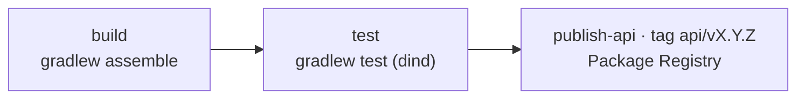

<h1 align="center">kraken-messaging</h1>

<p align="center">
  Axon-shaped messaging for Kotlin services: event, command and query buses over Kafka and the kraken hub, as a Spring Boot starter.
</p>

<p align="center">
  <a href="https://gitlab.damoreira.ml/kraken-org/kraken-messaging/-/pipelines"></a>
  <a href="https://gitlab.damoreira.ml/kraken-org/kraken-messaging/-/releases"></a>
  <a href="https://gitlab.damoreira.ml/kraken-org/kraken-messaging/-/packages"></a>
  
  
  
  
  <a href="https://gitlab.damoreira.ml/kraken-org/kraken/-/tree/main/docs"></a>
  <a href="LICENSE"></a>
</p>

---

Kotlin library for service-to-service messaging in the kraken platform. It provides the Axon-shaped `EventBus`,
`CommandBus` and `QueryBus` facades with `@EventHandler` / `@CommandHandler` / `@QueryHandler` annotations. Events travel
over Kafka with a MongoDB transactional outbox and an idempotent consumer; commands and queries travel over a gRPC stream
to the kraken hub. It ships as a Spring Boot 4.1 starter plus a test module.

Design and wire protocol: `../kraken/docs/02-messaging.md`. Test strategy: `../kraken/docs/09-observability-and-testing.md`.
Repo conventions: `../kraken/docs/04-repositories.md`.

## Table of contents

- [Modules](#modules)
- [Requirements](#requirements)
- [Build, test, publish](#build-test-publish)
- [Using the starter](#using-the-starter)
- [Semantics worth knowing](#semantics-worth-knowing)
- [Multiple hubs](#multiple-hubs)
- [Test helpers (`kraken-messaging-test`)](#test-helpers-kraken-messaging-test)
- [Examples](#examples)
- [Known limitations](#known-limitations)
- [CI/CD pipeline](#cicd-pipeline)
- [Contributing](#contributing)
- [License](#license)

## Modules

| Module | Coordinates | Purpose |
|---|---|---|
| `kraken-messaging-api` | `io.damoreira.kraken:kraken-messaging-api:0.1.0-SNAPSHOT` | `@MessageType`, `Event`, `Command<R>`, `Query<R>`. No Spring. Depended on by every `*-api` module. |
| `kraken-messaging` | `io.damoreira.kraken:kraken-messaging:0.1.0-SNAPSHOT` | Spring Boot starter: buses, handler annotations, hub client, outbox, Kafka consumer, auto-configuration. |
| `kraken-messaging-test` | `io.damoreira.kraken:kraken-messaging-test:0.1.0-SNAPSHOT` | `InMemoryBuses`, `InProcessHub`, `KrakenContainers`, `KrakenTestKafka`. |
| `examples/examples-api`, `examples/service-a`, `examples/service-b` | not published | Two sample services talking through the hub; see [Examples](#examples). |

## Requirements

- JDK 25 (Temurin), found on the PATH or by the Gradle toolchain resolver.
- Docker for the container tests (Kafka, MongoDB, and the hub image for the end-to-end test).

Rancher Desktop: Testcontainers needs two environment variables, otherwise it does not find the Docker socket.

```bash
export DOCKER_HOST=unix://$HOME/.rd/docker.sock
export TESTCONTAINERS_DOCKER_SOCKET_OVERRIDE=/var/run/docker.sock
```

or the equivalent lines in `~/.testcontainers.properties`:

```properties
docker.host=unix:///Users/<you>/.rd/docker.sock
testcontainers.docker.socket.override=/var/run/docker.sock
```

## Build, test, publish

```bash
./gradlew build                  # compile + all tests (needs Docker, see above)
./gradlew publishToMavenLocal    # installs 0.1.0-SNAPSHOT into ~/.m2 for the service repos
```

Publishing to the GitLab Package Registry happens in CI on tags matching `api/vX.Y.Z`: the `publish-api` job sets
`KRAKEN_GITLAB_MAVEN_URL` and authenticates with `CI_JOB_TOKEN`, then publishes all three modules with the tag's version.
Locally, set `KRAKEN_GITLAB_MAVEN_URL` and `KRAKEN_GITLAB_TOKEN` and run `./gradlew publish`.

The published POM and Gradle module metadata carry resolved versions for every dependency (Gradle `versionMapping`), and the
POM also imports the Spring Boot BOM, so consumers do not need to manage them. Builder call.

## Using the starter

### Dependency

```kotlin
// settings.gradle.kts / build.gradle.kts
repositories {
    mavenLocal()   // until the GitLab registry is wired into the service repos
    mavenCentral()
}

dependencies {
    implementation("io.damoreira.kraken:kraken-messaging:0.1.0-SNAPSHOT")
    // a service's *-api module depends on the api artifact only:
    // api("io.damoreira.kraken:kraken-messaging-api:0.1.0-SNAPSHOT")
    testImplementation("io.damoreira.kraken:kraken-messaging-test:0.1.0-SNAPSHOT")
}
```

Kotlin version note (Builder call): a project that applies `io.spring.dependency-management` must set the Kotlin version
in its build script, otherwise the Boot BOM pins the Kotlin compiler classpath to 2.3.x and `compileKotlin` fails with a
`getPluginClasspaths()` NullPointerException.

```kotlin
extra["kotlin.version"] = "2.4.21"   // the Kotlin version in your version catalog
```

### Configuration

```yaml
kraken:
  messaging:
    service-name: workouts          # Kafka consumer group, event source, hub registration
    type-prefix: workouts           # wire type prefix for classes without @MessageType
    hub:
      address: static://kraken-hub:7000
    kafka:
      bootstrap-servers: broker:19092
spring:
  mongodb:
    uri: mongodb://mongo:27017/workouts   # Spring Boot 4 key; spring.data.mongodb.uri is no longer bound
  security:
    oauth2:
      resourceserver:
        jwt:
          issuer-uri: https://keycloak.example/realms/kraken
```

The `issuer-uri` is only needed when the service also serves HTTP or wants forwarded tokens verified (see
[Security](#security)); Kafka-only tools and services behind the hub start without any security configuration.

All keys (`kraken.messaging.*`; durations accept `200ms`, `5s`, `7d`; relaxed binding, e.g. `KRAKEN_MESSAGING_HUB_ADDRESS`):

| Key | Default | Meaning |
|---|---|---|
| `service-name` | required | Kafka consumer group, event `source`, hub `Register.service_name`. |
| `type-prefix` | required | Prefix of the wire type name for message classes without `@MessageType`. |
| `hub.enabled` | `true` | Connect to the hub and expose the hub-backed `CommandBus`/`QueryBus` (addition beyond the spec table). |
| `hub.address` | `static://kraken-hub:7000` | The hub or hubs: one gRPC target (`host:port`, optional `static://` prefix), a comma-separated list of them (`hub-1:7000,hub-2:7000`, one connection per hub), or one `dns:///name:port` whose addresses are re-resolved every 30 s. See [Multiple hubs](#multiple-hubs). A malformed value fails the startup. |
| `hub.status-interval` | `5s` | Period of the `InstanceStatus` report (connected hub ids, handlers in flight) sent to every hub whose ack lists `instance-status`; also sent whenever the set of live hubs changes. Must be positive. |
| `hub.request-timeout` | unset | Per-request timeout sent as `timeout_ms`. Unset: a v2 hub applies its default (5 s) or its per-type override (`KRAKEN_HUB_TIMEOUT_OVERRIDES`), a legacy hub gets 5 s. Also bounds the wait for a hub stream (5 s when unset). `0s` counts as unset. |
| `hub.heartbeat-interval` | `10s` | Fallback heartbeat period, used only when the hub does not announce one (legacy hubs); a v2 hub announces 3 s in its `RegisterAck`. |
| `hub.reconnect-backoff.min` | `500ms` | Initial reconnect delay when the stream drops; doubles per failed attempt. |
| `hub.reconnect-backoff.max` | `5s` | Maximum reconnect delay. Every wait is jittered by ±20 % and capped at this value (at the cap: 80-100 % of it); the delay resets to `min` once an attempt reached the hub's handshake. |
| `hub.max-concurrent-handlers` | `256` | Incoming hub requests handled concurrently by this instance, over all hubs (at least 1, else the startup fails); further requests wait for a free slot. Also announced as `initial_permits` to a hub with flow control (split over N hubs: `ceil(max / N)` each), which then queues the excess on its side. |
| `hub.load-factor` | `100` | Relative capacity of this instance (`Register.load_factor`); weights its share of the hub's routing (keyed ring and load score). A negative value fails the startup; 0 is allowed (the hub reads it as 100). |
| `hub.tags.<name>` | none | Labels announced in `Register.tags`, for example `hub.tags.zone=eu-1`; unkeyed requests prefer instances whose tags match the sender's. |
| `hub.priorities.<type>` | none (0) | Default `Request.priority` per message type, for example `hub.priorities.orders.PlaceOrder=5`; higher is served first when the hub queues requests for a busy handler. `SendOptions.priority` wins. |
| `hub.retry.enabled` | `false` | Retry failed sends that are safe to retry (see "Retry" below). `SendOptions.retry` overrides per call. |
| `hub.retry.max-attempts` | `3` | Total attempts including the first (1 = no retry). The `hub.retry.*` values are validated at startup even while `enabled` is false: `max-attempts` < 1, `multiplier` < 1 or a negative backoff fails it. |
| `hub.retry.initial-backoff` | `100ms` | Wait before the second attempt. Every wait is jittered by ±20 % and capped at `max-backoff` (at the cap: 80-100 % of it). |
| `hub.retry.multiplier` | `2` | Growth of the wait per further attempt. |
| `hub.retry.max-backoff` | `2s` | Upper bound of a single wait. |
| `kafka.bootstrap-servers` | `broker:19092` | Kafka bootstrap servers. |
| `kafka.topic` | `kraken.events` | Events topic. |
| `kafka.consumer.enabled` | `true` | Set `false` in tools that only publish. |
| `kafka.consumer.max-attempts` | `5` | Handler invocations per record (first try included) before the record is logged and skipped. |
| `outbox.enabled` | `true` | Run the outbox publisher that relays `outbox` documents to Kafka. |
| `outbox.poll-interval` | `200ms` | Outbox poll period. |
| `outbox.batch-size` | `100` | Documents per poll. |
| `outbox.retention` | `7d` | Sent outbox documents older than this are deleted (TTL index). |
| `outbox.max-attempts` | `10` | Send attempts per outbox document before it is marked failed (`failedAt`) and skipped. |
| `idempotency.retention` | `30d` | `processed_events` documents older than this are deleted (TTL index). |
| `security.forward-jwt` | `true` | Put the current request's bearer token in the hub request's `authorization` header. |

### Security

Cross-service commands and queries are service-to-service calls on a private network, so they are **trusted by
default**: a request with no token is anonymous and is still handled. A handler that needs an authenticated user
opts in:

```kotlin
@CommandHandler
@RequiresAuthentication(expression = "hasRole('kraken-user')")
suspend fun handle(cmd: LogWorkout, ctx: MessageContext): LogWorkoutResult = ...

@QueryHandler
@RequiresAuthentication   // isAuthenticated()
fun handle(q: GetWorkout, ctx: MessageContext): GetWorkoutResult = ...

@CommandHandler
fun handle(cmd: RecomputeStats) { ... }   // no annotation: any caller, including event handlers and jobs
```

The expression is Spring Security SpEL evaluated by the **receiving** library before the handler runs:
`isAuthenticated()`, `hasRole('x')`, `hasAnyRole(...)`, `hasAuthority('ROLE_x')`, `principal` (a `MessagePrincipal`
with `userId`, `roles`, `verified`), plus `#message` (the decoded command or query) and `#ctx` (the `MessageContext`),
e.g. `"hasRole('kraken-user') and #message.ownerId == #ctx.userId"`. Realm roles from the token's `realm_access.roles`
become `ROLE_<role>` authorities. A syntax error fails startup naming the handler; `@RequiresAuthentication` is not
allowed on `@EventHandler` (events carry no identity). Annotated handlers are listed at startup at `INFO`.

Outcomes, on the hub path and the local short-circuit alike:

| Caller | Result at the sender |
|---|---|
| no identity (no token, or an event handler / job) | `UnauthenticatedException` (wire code `UNAUTHENTICATED`) |
| identity present, expression false or fails to evaluate | `AccessDeniedException` (wire code `PERMISSION_DENIED`) |
| identity present, expression true | handler runs |

A handler that throws `AccessDeniedException` (this library's or Spring's) also yields `PERMISSION_DENIED`, so a
nested send denied deeper in a chain reaches the original caller as `AccessDeniedException`.

How the receiver resolves the forwarded identity (`ForwardedIdentityResolver`):

| Forwarded `authorization` header | `JwtDecoder` bean | Result |
|---|---|---|
| absent | any | anonymous; `MessageContext.userId = null`, request proceeds |
| `Bearer <jwt>`, valid | present | identity `{sub, realm roles}`, `verified = true` |
| `Bearer <jwt>`, invalid or expired | present | `UNAUTHENTICATED` (a forged or stale token is a bug or an attack) |
| `Bearer <jwt>`, signed | absent | claims read **without verification**, `verified = false`; warned once per process |
| `Bearer <jwt>`, unsigned (`alg: none`) or encrypted | absent | `UNAUTHENTICATED` (only signed tokens are read unverified) |
| malformed | any | `UNAUTHENTICATED` |

Builder call: an unverified identity counts as authenticated. The peer that forwarded it validated it at its own
ingress and is trusted by the network model; verification is for catching forged or expired tokens where the
service can, not for distrusting the peer. Without a `JwtDecoder` the checks are therefore advisory: any client on
the private network can mint a signed token with any claims. Use `principal.verified` in an expression when a
handler must insist on a verified identity (`"isAuthenticated() and principal.verified"`). On the local
short-circuit the current Spring `Authentication` is normalised the same way: `sub` and `realm_access.roles` are
read from the token (`JwtAuthenticationToken`, `BearerTokenAuthentication`), so `hasRole('x')` means the realm role
regardless of how the application maps authorities for its own REST endpoints.

Notes:

- `@RequiresAuthentication` is read from the handler method itself and is not inherited from an interface or
  superclass method.
- `permitAll()`, `denyAll()` and `isAnonymous()` are accepted syntax but meaningless here: an anonymous caller is
  rejected with `UNAUTHENTICATED` before any expression runs, so leave the annotation off a handler open to anyone.
- A string result such as `'true'` is not a grant; the expression must evaluate to the Boolean `true`.
- An expression that throws (for example `#message.owner.id` on a null `owner`) is a denial, not a handler error.

The resolved identity is installed in the `SecurityContext` while the handler runs, so `CallerContext` works inside
handlers and nested sends re-forward the same token. `kraken.messaging.security.require-jwt` was removed; setting it
fails startup with a hint.

### Handlers

```kotlin
@Component
class WorkoutHandlers(private val repo: WorkoutRepository, private val events: EventBus) {

    // @Transactional handlers are plain (non-suspend) functions: see "Transactions" below.
    @CommandHandler
    @Transactional
    fun handle(cmd: LogWorkout, ctx: MessageContext): LogWorkoutResult {
        val workout = repo.save(Workout.from(cmd, ownerId = ctx.userId))
        events.publishBlocking(WorkoutLogged(workout.id, workout.ownerId, workout.loggedAt), key = workout.id)
        return LogWorkoutResult(workout.id)
    }

    @QueryHandler
    suspend fun handle(q: GetWorkout): GetWorkoutResult =
        repo.findById(q.workoutId)?.toResult() ?: throw NotFoundException(q.workoutId)

    @EventHandler
    suspend fun on(e: FileDeleted) {
        repo.detachFile(e.fileId)
    }
}
```

`Workout`, `WorkoutRepository` and `NotFoundException` are illustrative service types, not library classes.

Messages are plain data classes implementing the marker interfaces from the api module:

```kotlin
@MessageType("workouts.LogWorkout")
data class LogWorkout(val name: String) : Command<LogWorkoutResult>
```

### Sending

```kotlin
val logged = commandBus.send(LogWorkout("legs"))                 // suspend
val loggedNow = commandBus.sendBlocking(LogWorkout("legs"))      // blocking, for MVC controllers
val workout = queryBus.send(GetWorkout(id))
eventBus.publish(WorkoutLogged(id, owner, at), key = id)         // inside the caller's Mongo transaction

// Per call: priority, timeout (the total budget with retry), routing key, retry policy.
val urgent = commandBus.send(
    LogWorkout("legs"),
    SendOptions(priority = 10, timeout = Duration.ofSeconds(2), routingKey = id, retry = RetryPolicy(maxAttempts = 3)),
)
val quick = queryBus.sendBlocking(GetWorkout(id), SendOptions(retry = RetryPolicy.NONE)) // no retry for this call
```

## Semantics worth knowing

- **Typed facades.** `Command<R>` and `Query<R>` carry the response type; it is read from the interface type argument at
  runtime. Generic responses such as `List<X>` are erased, so wrap them in a response class. Builder call.
- **Local short-circuit.** A command or query whose handler lives in the same service is invoked locally and does not go
  through the hub. The handler runs on the caller's thread and coroutine, so it joins the caller's thread-bound
  transaction (a failure in it rolls back the caller's writes too) and sees the caller's security context.
- **Incoming hub requests** run on virtual threads, at most `hub.max-concurrent-handlers` at once, never on the threads
  that read the hub stream; a handler may block (for example on a nested `sendBlocking`).
- **Correlation id.** Every message carries a `correlationId`. Messages sent while handling a hub request or a Kafka
  event reuse the incoming id (carried in the coroutine context and mirrored into the SLF4J MDC key `correlationId`);
  otherwise the MDC value is used, else a fresh UUID.
- **Request ids.** `Request.id` is fresh per attempt. A retried command must carry its own business id in the payload.
- **Identity.** The caller's bearer token is forwarded on the hub path only (`security.forward-jwt`). Requests are
  trusted by default: a request without a token is anonymous and still handled. See [Security](#security) for
  `@RequiresAuthentication`. Builder call.
- **Events** carry `userId` only, not the token. Events published from an `@EventHandler` carry an empty `userId`:
  the consumer has no forwarded token, only the incoming event's `userId` in `MessageContext`.
- **Outbox ordering.** Events with the same key are published in order per publishing instance, using a `seq` field on the
  outbox document. Builder call.
- **Outbox failures.** A send failure that retrying cannot fix (record too large, serialization, invalid topic,
  authorization) or the `outbox.max-attempts`-th failure marks the document failed (`failedAt`), logs it once at error and
  moves on; other failures stop the batch and are retried on the next poll. Failed documents stay in `outbox` (the TTL
  only removes sent ones); clear `failedAt` and `attempts` to re-queue one.
- **Consumer idempotency.** The consumer records processed event ids in `processed_events` and skips duplicates. A handler
  gets up to `max-attempts` invocations with a 1 s back-off; a record that still fails is logged and skipped. A payload
  that does not decode into the handler's class is skipped at once. There is no dead-letter topic.
- **Transactions.** The library invokes `@EventHandler`s inside its own Mongo transaction (idempotency marker plus the
  handler's writes), on the Kafka listener thread via `runBlocking`; a handler that relies on it must not switch threads.
  The `MongoTransactionManager` is thread-bound: Spring only carries a transaction across suspensions for reactive
  transaction managers, so a `@Transactional suspend` function loses its transaction at the first real suspension (an
  awaited `send`, `delay`, `withContext` to another dispatcher) and later writes are not part of it. Rules:
  - make `@Transactional` handlers non-suspend functions, or make sure they do not suspend before their last write;
  - `eventBus.publish`/`publishBlocking` only insert into `outbox` and never suspend, so they are safe inside the
    transaction;
  - to send a command or query as well, commit first and send afterwards, for example a non-suspend `@Transactional`
    service method that does the writes, called from the handler, followed by `commandBus.send(...)`:

    ```kotlin
    @CommandHandler
    suspend fun handle(cmd: CloseWorkout, ctx: MessageContext): Unit {
        val workout = workouts.close(cmd.workoutId)          // @Transactional, non-suspend: commits on return
        commandBus.send(NotifyOwner(workout.ownerId))        // after the commit
    }
    ```
- **Shutdown.** The hub connection, outbox publisher and Kafka consumer start before the web server accepts traffic and
  stop after its graceful drain. On stop the instance first announces an empty registration so the hub stops routing to
  it, waits up to 5 s for incoming handlers still running, then closes the stream.
- **Handshake.** `Register` announces protocol version 2 (`HubProtocol`), the `flow-control` capability and `client_version`
  `kraken-messaging/<version>`. A v2 hub answers with a `RegisterAck` (hub id, heartbeat interval and timeout, default,
  maximum and per-type request timeouts) before the echo of the first heartbeat; a hub whose echo arrives first is a
  legacy (v1) hub and the connection keeps the pre-v2 behaviour (10 s heartbeats, `timeout_ms` always sent).
  `HubConnection.handshake` tells which (per hub: `HubConnections.connections()`).
- **Timeouts.** Unless `hub.request-timeout` is set, requests go out with `timeout_ms = 0` and the hub decides (default
  or per-type override). The client gives up locally only when the hub never answers: after the hub's deadline bound
  from the ack (`min(timeout, override or max)`, or `override or max` for 0) plus 1 s, with `MessageTimeoutException`.
- **Dead connections.** A hub stream whose heartbeats stay unanswered for three heartbeat intervals (9 s against a v2
  hub) is closed and re-established; HTTP/2 keepalive pings (every 10 s, 5 s timeout, also without calls) run on the
  channel.
- **Lost connections.** A request the stream never accepted (including one still queued on the client when the stream
  broke) fails with `HubUnavailableException` (the handler did not run, retrying is safe; with several hubs it is sent to
  another hub first). A request written to a stream that broke before the answer fails with
  `HubConnectionLostException`: the outcome is unknown, as with a timeout.
- **Flow control.** `Register` declares the `flow-control` capability with `initial_permits = hub.max-concurrent-handlers`.
  A hub that shares it (its ack lists `flow-control`) forwards to this instance only against permits and queues the rest
  per instance, highest `Request.priority` first, each request keeping its own deadline; every completed handler pays
  one permit back on the stream the request arrived on. Permits go back at once while the hub holds at most
  `min(16, initial_permits / 2)` of them for the stream (so a single permit is never held back), otherwise batched (one
  `Permits` message per 16 grants or 50 ms). A slow handler therefore means latency, not timeouts or `handler busy`. Against a hub without the capability (P0 or older)
  nothing changes and no `Permits` are sent.
- **Busy handlers.** A full hub queue or session buffer answers `HandlerBusyException` (`RESOURCE_EXHAUSTED`): the
  request was rejected before any handler ran, so retrying later is safe. Older clients get `RemoteHandlerException`
  "handler busy" instead.
- **Retry** (opt-in, `hub.retry.*` or `SendOptions.retry`). Only errors `RetryClassification.isRetryable` allows are
  retried: for commands `HubUnavailableException`, `NoHandlerException`, `HandlerBusyException`; for queries also
  `HandlerDisconnectedException`, `MessageTimeoutException`, `HubConnectionLostException`. A command is never retried after
  a timeout or a lost connection (it may have run). Each attempt is a new request (fresh id, same correlation id); all
  attempts share one budget, the chosen timeout or else the hub's deadline for the type (its per-type override or
  default), each sending the remaining budget as `timeout_ms`. A retry starts only if at least
  `max(initial-backoff, 250ms)` of the budget is left after its backoff; otherwise the last error is thrown at once.
  Local handlers (same instance) are never retried.
- **Hub errors.** The hub answers malformed or duplicate in-flight requests with `INVALID_REQUEST`; other hub errors map to
  the exception types in `io.damoreira.kraken.messaging` (`NoHandlerException`, `UnauthenticatedException`, ...).

## Multiple hubs

kraken-hub reaches high availability through several independent hubs that never talk to each other (ADR 0016 in the
umbrella repo): every instance connects to every hub, and the client decides where each request goes.

```yaml
kraken.messaging.hub.address: static://hub-1:7000,static://hub-2:7000   # or: dns:///kraken-hub:7000
```

- **One connection per hub.** `HubConnections` opens one `Connect` stream per target, each with its own handshake,
  heartbeat, reconnect backoff and legacy detection, and sends the identical `Register` on every one (re-sent on every
  reconnect). One target behaves exactly like the single-hub client.
- **Targets.** A comma-separated list (blank entries and repeats dropped, order kept), or a single `dns:///name:port`
  (port required, not combinable with other entries) resolved at start and every 30 s: a new address gets a connection,
  a vanished one first announces an empty registration, then is closed once idle (at most 30 s later). A failed or empty
  resolution keeps the current connections.
- **Hub identity.** A hub is its `RegisterAck.hub_id`; a legacy (v1) hub, which sends none, is its target string. When
  two targets answer the same id, the one that acknowledged first is kept and the other closed (logged once).
- **Live hubs** are the kept connections whose stream completed its handshake.
- **Routing.** A request without a routing key goes round-robin over the live hubs; a hub that is reconnecting is
  skipped. A request with a routing key (`SendOptions.routingKey`) goes to the live hub with the highest rendezvous score
  for (routing key, hub id), so a key keeps its hub while the hubs are stable and only the keys of a hub that leaves
  move; the hub's own consistent-hash ring then keeps it on one instance. Replies always go back on the stream the
  request arrived on.
- **Rendezvous score** (identical in the Rust library): `fmix64(fnv1a64(utf8(hub_id + "\u0000" + routing_key)))`, compared
  as unsigned 64-bit; equal scores go to the smaller hub id. `fnv1a64` is 64-bit FNV-1a (offset basis
  `0xcbf29ce484222325`, prime `0x100000001b3`); `fmix64` is MurmurHash3's 64-bit finalizer (`k ^= k >>> 33;
  k *= 0xff51afd7ed558ccd; k ^= k >>> 33; k *= 0xc4ceb9fe1a85ec53; k ^= k >>> 33`). Vectors: `score("hub-a",
  "order-1") = 0xd8d5618ff3a93f55`, `score("hub-b", "key-0") = 0xbd443f5acaf98254` (`RendezvousTest`).
- **Failover.** A request its hub could not take before it was written (the stream had just closed, or broke while the
  request was still queued on the client) is sent to another live hub, unchanged; with no hub left the call waits for
  one, up to `hub.request-timeout` (5 s when unset), then fails with `HubUnavailableException`. A request already
  written fails with `HubConnectionLostException` (or the hub's `HandlerDisconnectedException`), and the retry policy
  applies as before. With no live hub at all: `HubUnavailableException`, as with one hub.
- **Permits.** A stream announces `ceil(hub.max-concurrent-handlers / N)` initial permits, where N = 1 (the hub being
  registered on) + the other hubs that are live or still on their first connect attempt (a hub down after a failed
  attempt is not counted); permits are never revoked when N changes. Locally at most `hub.max-concurrent-handlers` handlers run in total, whichever hub sent the
  requests. Permits are paid back per stream as before.
- **Status.** Every `hub.status-interval`, and whenever the live set changes, each live hub whose ack lists the
  `instance-status` capability gets an `InstanceStatus`: `connected_hub_ids` (the ids of the live protocol v2 hubs) and
  `handlers_in_flight` (over all hubs). A hub without the capability (P2 or older, legacy) never gets one. The hub shows
  the report in its topology (`connectedHubIds`, `statusAgeMs`) and the dashboard flags instances missing a hub.
- **Shutdown** announces the empty registration on every hub, waits for the handlers, then closes every stream.

## Test helpers (`kraken-messaging-test`)

- `InMemoryBuses(typePrefix, userId)`: implements `EventBus`, `CommandBus` and `QueryBus` in memory for unit tests without
  Docker. Messages still pass through the JSON codec. `register(handlerBean)` adds handlers; `published` lists events.
- `InProcessHub`: in-JVM stand-in for the hub (`start()`, `channel()`, `dropInstance(...)`, `lastRequestHeaders()`,
  `lastRequest()`, `registrationsFrom(...)`, `lastRegisterFrom(...)`, `acksSentTo(...)`, `echoHeartbeats = false` to
  simulate a hub that stopped answering), for hub-client tests without a container. It speaks protocol v2 (a
  `RegisterAck` with `heartbeatInterval`, `heartbeatTimeout`, `replyTimeout` as default, `maxTimeout`, `typeTimeouts`);
  `legacy = true` emulates a v1 hub, `emitTimeouts = false` a hub that loses requests. Flow control as the real hub:
  permits, a per-instance queue by priority (`queueCapacity`), `RESOURCE_EXHAUSTED` or "handler busy" by sender capability,
  `permitsGrantedBy(...)`, `permitMessagesFrom(...)`, `permitsAvailable(...)`, `queuedFor(...)`, `forwardedOrder()`;
  `flowControl = false` emulates the P0 hub (v2 without flow control). Multi-hub: `instanceStatus = false` emulates the
  P2 hub (no `instance-status`), `lastStatusFrom(...)`, `statusMessagesFrom(...)`, `requestsFrom(...)`, `sessionsOf(...)`,
  and `pauseReading = true` stops reading every stream.
- `KrakenContainers`: unstarted Testcontainers definitions. `kafka()`, `mongo()` (single-node replica set, needed for
  transactions), `hub()` from image `kraken-hub:dev` or the one named by `KRAKEN_HUB_IMAGE`, `hubBaseline()` from the previous hub release
  `kraken-hub:v1-baseline` or `KRAKEN_HUB_BASELINE_IMAGE` and `hubP0()` from the P0 hub `kraken-hub:p0` or
  `KRAKEN_HUB_P0_IMAGE`, `hubP2()` from `kraken-hub:p2` or `KRAKEN_HUB_P2_IMAGE` (compatibility tests), `hubP3()` from
  `kraken-hub:p3-hub` or `KRAKEN_HUB_P3_IMAGE` with ports 7000 and 7001 (two-hub tests), `hub(env)` for the hub under test with extra `KRAKEN_HUB_*` settings, and
  `hubImageAvailable()` / `hubBaselineImageAvailable()` / `hubP0ImageAvailable()` / `hubP2ImageAvailable()` /
  `hubP3ImageAvailable()`.
- `KrakenTestKafka(bootstrap, typePrefix, topic).awaitEvent<T>()`: reads an event back from the topic.

```kotlin
val buses = InMemoryBuses(typePrefix = "workouts")
buses.register(WorkoutHandlers(repo, buses))   // the handler publishes events through the same in-memory bus
val result = buses.sendBlocking(LogWorkout("legs"))
```

The end-to-end test (`TwoServicesEndToEndTest`) starts Kafka, MongoDB, the real hub and two Spring Boot services. It is
skipped when `kraken-hub:dev` (or the image named by `KRAKEN_HUB_IMAGE`) is not present in the local Docker daemon. Build the image from the kraken-hub repo:

```bash
docker build -t kraken-hub:dev .
```

## Examples

`examples/` holds two tiny Spring Boot services built on this starter: service-a sends a command and a query over
the hub and reacts to an event, service-b owns the command and the query and publishes the event. They run in
Docker Compose from local builds together with the real `kraken-hub` image, Kafka and MongoDB, and are driven with
`curl`. See [examples/README.md](examples/README.md).

## Known limitations

- No dead-letter topic: poison records are logged and skipped.
- No leader election for the outbox publisher; with several instances delivery is at-least-once and ordering is per
  publishing instance.
- No scatter-gather (one command or query reaches one handler instance).
- Library metrics are not exported yet; OpenTelemetry comes from the application.
- Configuration metadata is hand-maintained in `META-INF/spring-configuration-metadata.json`.
- `TraceHeaders` is only active with Micrometer Tracing on the classpath.
- Trace context is injected on outbound messages (hub requests, outbox events) but not yet extracted on inbound hub
  requests or Kafka records, so a handler's spans do not join the caller's trace.
- No service-to-service identity yet: commands sent from event handlers or scheduled jobs carry no token, so they can
  only reach handlers without `@RequiresAuthentication` (a `kraken-system` client-credentials token is future work).


## CI/CD pipeline

Defined in [`.gitlab-ci.yml`](.gitlab-ci.yml); runs on every push and merge request on
`eclipse-temurin:25-jdk`.



| Stage | Job | Runs | Produces |
|---|---|---|---|
| build | `build` | always | compiled modules |
| test | `test` | always, with a `docker:dind` service; the hub end-to-end test is skipped when the hub image is not reachable | JUnit report |
| publish | `publish-api` | only on tags `api/vX.Y.Z` | `kraken-messaging-api`, `kraken-messaging` and `kraken-messaging-test` at `X.Y.Z` in the Package Registry |

Consumers resolve the artifacts from the group endpoint
`https://gitlab.damoreira.ml/api/v4/groups/kraken-org/-/packages/maven`. No Docker image is built: this
is a library; the example services are built from source by the sandbox compose.

## Contributing

Branches `feat/<topic>`, `fix/<topic>`, `chore/<topic>` off `main`, merged by merge request with a
green pipeline; conventional commit messages. Design changes go to the umbrella repo first.
Conventions: [`../kraken/docs/04-repositories.md`](../kraken/docs/04-repositories.md).

## License

[MIT](LICENSE) © 2026 Guilherme D'Amoreira.
